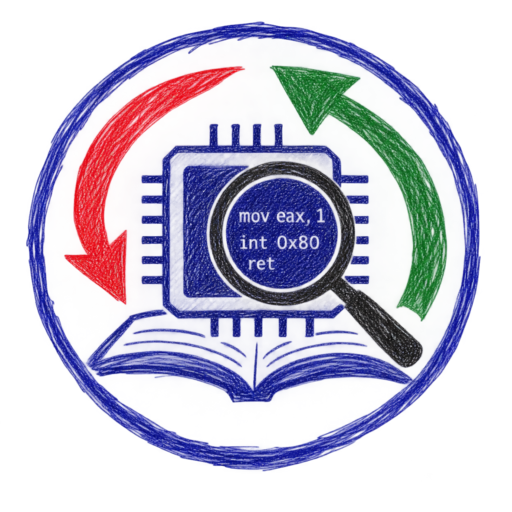
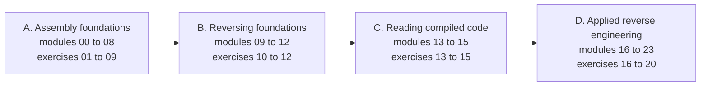

<!-- source: README.md @ sha256:f54fdc1a6476 -->
<div align="center">



[English](README.md) | [العربية](README.ar.md) | [Deutsch](README.de.md) | [Español](README.es.md) | [Français](README.fr.md)

# ASM Reversing Lab

</div>

<div dir="rtl">

دورة مجانية وعملية تعلّمك **لغة التجميع** و**الهندسة العكسية** معاً. ستتعلم كتابة شيفرة التجميع لمعماريتي x86 وx86-64، وقراءة شيفرة الآلة التي تنتجها المترجمات، على نظامي Linux وWindows.

لكل تمرين من التمارين العشرين جزءان يعتمد كل منهما على الآخر. في جزء **الهندسة العكسية (Reverse)** تحلل ملفاً تنفيذياً مقدماً لك وتستخرج علماً (flag). وفي جزء **التجميع (Assemble)** تكتب شيفرة NASM وفق مواصفات لا يمكنك فهمها بالكامل إلا بعد إنهاء الجزء الأول. ويختبر مدقق آلي الجزأين معاً.

## لمن هذه الدورة

تعرف أساسيات لغة C وتريد أن تفهم ما يحدث تحتها. لا تحتاج إلى خبرة سابقة في لغة التجميع أو الهندسة العكسية.

## ماذا ستتعلم

- تمثيل البيانات، والسجلات، والرايات، وأنماط العنونة، والحساب، وتدفق التحكم، والسلاسل النصية، والمكدس، واصطلاحات الاستدعاء، في الشيفرة ذات 32 بت و64 بت.
- صيغتا الملفات التنفيذية ELF وPE وكيف تحمّل أنظمة التشغيل البرامج.
- عدة عمل احترافية: GDB مع GEF، وobjdump، وRizin، وGhidra.
- التعرف على بنى الشيفرة المترجمة، والحساب المحسَّن، وهياكل البيانات، وكائنات C++.
- التحليل التطبيقي: الواجهات غير الموثقة، وصيغ الملفات، وتدقيق الأخطاء، والفرز الدفاعي للبرامج المشبوهة، والشيفرة المعتَّمة، والآلات الافتراضية للشيفرة البايتية، و.NET، وأدوات فك الترجمة.

## هيكل الدورة

| الجزء | الوحدات | الموضوع |
|---|---|---|
| A | 00 إلى 08 | أسس لغة التجميع |
| B | 09 إلى 12 | أسس الهندسة العكسية |
| C | 13 إلى 15 | قراءة الشيفرة المترجمة |
| D | 16 إلى 23 | الهندسة العكسية التطبيقية |



تأتي بعد الوحدات عشرون تمريناً، من المستوى 1 إلى المستوى 5. ابدأ بـ [الوحدة 00](modules/00-setup/README.ar.md) التي تجهّز المختبر.

## البدء السريع

تحتاج إلى Docker. جميع الأدوات مثبّتة مسبقاً في صورة المختبر.

</div>

```bash
git clone https://github.com/RiadMoudjahed/asm-reversing-lab.git
cd asm-reversing-lab
make shell
```

<div dir="rtl">

داخل المختبر، تحقق من تمرين بالأمر `make check EX=01`. هل تفضّل التثبيت المباشر على Ubuntu أو Debian؟ شغّل `sudo scripts/install-native.sh` ثم استخدم `make NATIVE=1 <target>`. تُثبَّت Ghidra على جهازك المضيف، وتشرح وحدة الإعداد كيفية ذلك.

## اللغات

كل صفحات الدورة متاحة بالإنجليزية والعربية والألمانية والإسبانية والفرنسية. أُعدّت الترجمات بمساعدة الذكاء الاصطناعي، وتصحيحات الناطقين الأصليين موضع ترحيب (انظر [CONTRIBUTING.ar.md](CONTRIBUTING.ar.md)).

## الحالة

كُتبت الوحدات الأربع والعشرون والتمارين العشرون وأوراق المراجع والمسرد، وتجتاز الفحوص الآلية باللغات الخمس.

## الاستخدام المسؤول

حلّل فقط البرمجيات التي يحق لك تحليلها. اقرأ [ETHICS.ar.md](ETHICS.ar.md) قبل أن تبدأ. لا تتضمن الدورة تطوير استغلالات، ولا تطوير برمجيات خبيثة، ولا أي شيء عن تجاوز حمايات البرمجيات.

## الترخيص

الشيفرة مرخَّصة بموجب رخصة MIT ([LICENSE](LICENSE)). المحتوى المكتوب والمخططات مرخَّصة بموجب CC BY-SA 4.0 ([LICENSE-CONTENT](LICENSE-CONTENT)).

</div>
