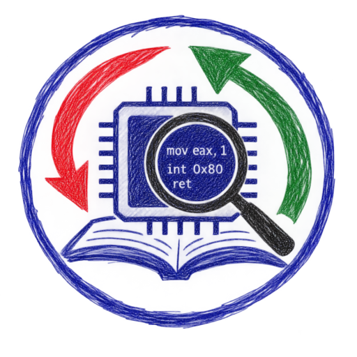
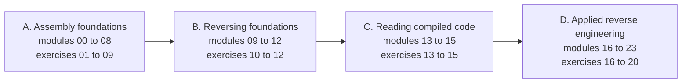

<!-- source: README.md @ sha256:f54fdc1a6476 -->
<div align="center">



[English](README.md) | [العربية](README.ar.md) | [Deutsch](README.de.md) | [Español](README.es.md) | [Français](README.fr.md)

# ASM Reversing Lab

</div>

Ein kostenloser, praxisorientierter Kurs, der **Assemblersprache** und **Reverse Engineering** gemeinsam vermittelt. Sie lernen, x86- und x86-64-Assembler zu schreiben und den Maschinencode zu lesen, den Compiler erzeugen, unter Linux und unter Windows.

Jede der 20 Übungen besteht aus zwei Teilen, die aufeinander aufbauen. Im Teil **Reverse** analysieren Sie eine bereitgestellte Binärdatei und ermitteln ein Flag. Im Teil **Assemble** schreiben Sie NASM-Code nach einer Spezifikation, die Sie erst nach dem ersten Teil vollständig verstehen. Ein automatischer Prüfer testet beide Teile.

## Für wen der Kurs gedacht ist

Sie kennen die Grundlagen von C und möchten verstehen, was darunter geschieht. Vorkenntnisse in Assembler oder Reverse Engineering sind nicht nötig.

## Was Sie lernen

- Datendarstellung, Register, Flags, Adressierungsarten, Arithmetik, Kontrollfluss, Zeichenketten, Stapel und Aufrufkonventionen in 32-Bit- und 64-Bit-Code.
- Die Dateiformate ELF und PE und wie Betriebssysteme Programme laden.
- Professionelles Werkzeug: GDB mit GEF, objdump, Rizin und Ghidra.
- Das Erkennen von Codestrukturen, optimierter Arithmetik, Datenstrukturen und C++-Objekten in kompiliertem Code.
- Angewandte Analyse: undokumentierte Schnittstellen, Dateiformate, Fehlersuche in Binärdateien, defensive Triage verdächtiger Programme, verschleierter Code, Bytecode-Maschinen, .NET und Dekompilierer.

## Kursaufbau

| Teil | Module | Thema |
|---|---|---|
| A | 00 bis 08 | Grundlagen der Assemblersprache |
| B | 09 bis 12 | Grundlagen des Reverse Engineering |
| C | 13 bis 15 | Kompilierten Code lesen |
| D | 16 bis 23 | Angewandtes Reverse Engineering |



Zwanzig Übungen von Level 1 bis Level 5 folgen auf die Module. Beginnen Sie mit [Modul 00](modules/00-setup/README.de.md), das das Labor einrichtet.

## Schnellstart

Sie benötigen Docker. Alle Werkzeuge sind im Lab-Image vorinstalliert.

```bash
git clone https://github.com/RiadMoudjahed/asm-reversing-lab.git
cd asm-reversing-lab
make shell
```

Im Lab prüfen Sie eine Übung mit `make check EX=01`. Möchten Sie lieber nativ unter Ubuntu oder Debian installieren? Führen Sie `sudo scripts/install-native.sh` aus und verwenden Sie dann `make NATIVE=1 <target>`. Ghidra wird auf Ihrem Hostrechner installiert; das Einrichtungsmodul erklärt, wie.

## Sprachen

Alle Kursseiten gibt es auf Englisch, Arabisch, Deutsch, Spanisch und Französisch. Die Übersetzungen wurden mit KI-Unterstützung entworfen; Korrekturen von Muttersprachlern sind willkommen (siehe [CONTRIBUTING.de.md](CONTRIBUTING.de.md)).

## Status

Alle 24 Module, 20 Übungen, Spickzettel und das Glossar sind geschrieben und bestehen die automatischen Prüfungen in allen fünf Sprachen.

## Verantwortungsvolle Nutzung

Analysieren Sie nur Software, zu deren Analyse Sie berechtigt sind. Lesen Sie [ETHICS.de.md](ETHICS.de.md), bevor Sie beginnen. Der Kurs enthält keine Exploit-Entwicklung, keine Entwicklung von Schadsoftware und nichts zur Umgehung von Softwareschutz.

## Lizenz

Der Code steht unter der MIT-Lizenz ([LICENSE](LICENSE)). Geschriebene Inhalte und Diagramme stehen unter CC BY-SA 4.0 ([LICENSE-CONTENT](LICENSE-CONTENT)).
