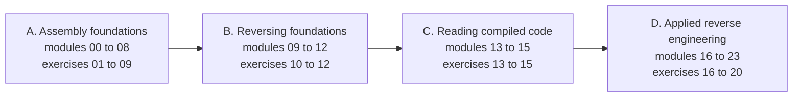

<!-- source: README.md @ sha256:327e8560dfa8 -->
[English](README.md) | [العربية](README.ar.md) | [Deutsch](README.de.md) | [Español](README.es.md) | [Français](README.fr.md)

# asm-reversing-lab

Un curso gratuito y práctico que enseña **lenguaje ensamblador** e **ingeniería inversa** a la vez. Aprenderás a escribir ensamblador x86 y x86-64 y a leer el código máquina que producen los compiladores, tanto en Linux como en Windows.

Cada uno de los 20 ejercicios tiene dos partes que dependen la una de la otra. En la parte **Reverse** analizas un binario proporcionado y obtienes una bandera (flag). En la parte **Assemble** escribes código NASM según una especificación que solo puedes comprender del todo después de terminar la primera parte. Un verificador automático prueba ambas.

## A quién va dirigido

Conoces lo básico de C y quieres entender qué ocurre por debajo. No se necesita experiencia previa en ensamblador ni en ingeniería inversa.

## Qué aprenderás

- Representación de datos, registros, indicadores, modos de direccionamiento, aritmética, flujo de control, cadenas, la pila y convenciones de llamada, en código de 32 y de 64 bits.
- Los formatos ejecutables ELF y PE y cómo los sistemas operativos cargan los programas.
- Un conjunto de herramientas profesional: GDB con GEF, objdump, Rizin y Ghidra.
- Reconocer estructuras de código compilado, aritmética optimizada, estructuras de datos y objetos de C++.
- Análisis aplicado: interfaces sin documentar, formatos de archivo, auditoría de errores, triaje defensivo de programas sospechosos, código ofuscado, máquinas virtuales de bytecode, .NET y descompiladores.

## Estructura del curso

| Parte | Módulos | Tema |
|---|---|---|
| A | 00 a 08 | Fundamentos de ensamblador |
| B | 09 a 12 | Fundamentos de ingeniería inversa |
| C | 13 a 15 | Leer código compilado |
| D | 16 a 23 | Ingeniería inversa aplicada |



Veinte ejercicios, de Level 1 a Level 5, siguen a los módulos. Empieza por el [módulo 00](modules/00-setup/README.es.md), que prepara el laboratorio.

## Inicio rápido

Necesitas Docker. Todas las herramientas vienen preinstaladas en la imagen del laboratorio.

```bash
git clone https://github.com/RiadMoudjahed/asm-reversing-lab.git
cd asm-reversing-lab
make shell
```

Dentro del laboratorio, comprueba un ejercicio con `make check EX=01`. ¿Prefieres una instalación nativa en Ubuntu o Debian? Ejecuta `sudo scripts/install-native.sh` y usa después `make NATIVE=1 <target>`. Ghidra se instala en tu equipo anfitrión; el módulo de configuración explica cómo.

## Idiomas

Todas las páginas del curso están disponibles en inglés, árabe, alemán, español y francés. Las traducciones se redactaron con ayuda de IA; las correcciones de hablantes nativos son bienvenidas (consulta [CONTRIBUTING.es.md](CONTRIBUTING.es.md)).

## Estado

Los 24 módulos, los 20 ejercicios, las hojas de referencia y el glosario están escritos y superan las comprobaciones automáticas en los cinco idiomas.

## Uso responsable

Analiza solo software que tengas derecho a analizar. Lee [ETHICS.es.md](ETHICS.es.md) antes de empezar. El curso no contiene desarrollo de exploits, ni desarrollo de malware, ni nada sobre cómo eludir protecciones de software.

## Licencia

El código se publica bajo la licencia MIT ([LICENSE](LICENSE)). El contenido escrito y los diagramas se publican bajo CC BY-SA 4.0 ([LICENSE-CONTENT](LICENSE-CONTENT)).
