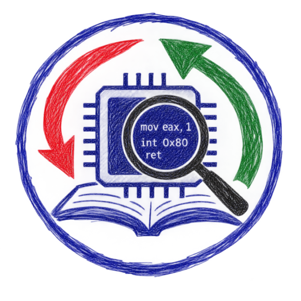
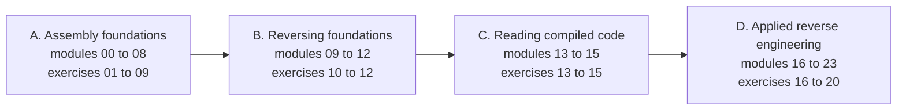

<!-- source: README.md @ sha256:f54fdc1a6476 -->
<div align="center">



[English](README.md) | [العربية](README.ar.md) | [Deutsch](README.de.md) | [Español](README.es.md) | [Français](README.fr.md)

# ASM Reversing Lab

</div>

Un cours gratuit et pratique qui enseigne ensemble le **langage d'assemblage** et la **rétro-ingénierie**. Vous apprendrez à écrire de l'assembleur x86 et x86-64 et à lire le code machine produit par les compilateurs, sous Linux comme sous Windows.

Chacun des 20 exercices comporte deux parties qui dépendent l'une de l'autre. Dans la partie **Reverse**, vous analysez un binaire fourni et en tirez un drapeau (flag). Dans la partie **Assemble**, vous écrivez du code NASM selon une spécification que vous ne pouvez comprendre entièrement qu'après avoir terminé la première partie. Un vérificateur automatique teste les deux.

## À qui s'adresse ce cours

Vous connaissez les bases du C et vous voulez comprendre ce qui se passe en dessous. Aucune expérience préalable de l'assembleur ou de la rétro-ingénierie n'est requise.

## Ce que vous apprendrez

- La représentation des données, les registres, les indicateurs, les modes d'adressage, l'arithmétique, le flux de contrôle, les chaînes, la pile et les conventions d'appel, en code 32 bits et 64 bits.
- Les formats exécutables ELF et PE et la façon dont les systèmes d'exploitation chargent les programmes.
- Une boîte à outils professionnelle : GDB avec GEF, objdump, Rizin et Ghidra.
- La reconnaissance des structures de code compilé, de l'arithmétique optimisée, des structures de données et des objets C++.
- L'analyse appliquée : interfaces non documentées, formats de fichiers, audit de bogues, triage défensif de programmes suspects, code obscurci, machines virtuelles à bytecode, .NET et décompilateurs.

## Organisation du cours

| Partie | Modules | Sujet |
|---|---|---|
| A | 00 à 08 | Fondations de l'assembleur |
| B | 09 à 12 | Fondations de la rétro-ingénierie |
| C | 13 à 15 | Lire du code compilé |
| D | 16 à 23 | Rétro-ingénierie appliquée |



Vingt exercices, du Level 1 au Level 5, suivent les modules. Commencez par le [module 00](modules/00-setup/README.fr.md), qui met en place le laboratoire.

## Démarrage rapide

Vous avez besoin de Docker. Tous les outils sont préinstallés dans l'image du laboratoire.

```bash
git clone https://github.com/RiadMoudjahed/asm-reversing-lab.git
cd asm-reversing-lab
make shell
```

Dans le laboratoire, vérifiez un exercice avec `make check EX=01`. Vous préférez une installation native sous Ubuntu ou Debian ? Exécutez `sudo scripts/install-native.sh`, puis utilisez `make NATIVE=1 <target>`. Ghidra s'installe sur votre machine hôte ; le module de mise en place explique comment.

## Langues

Toutes les pages du cours sont disponibles en anglais, arabe, allemand, espagnol et français. Les traductions ont été rédigées avec l'aide de l'IA ; les corrections de locuteurs natifs sont les bienvenues (voir [CONTRIBUTING.fr.md](CONTRIBUTING.fr.md)).

## État du projet

Les 24 modules, les 20 exercices, les aide-mémoire et le glossaire sont rédigés et passent les vérifications automatiques dans les cinq langues.

## Usage responsable

N'analysez que les logiciels que vous avez le droit d'analyser. Lisez [ETHICS.fr.md](ETHICS.fr.md) avant de commencer. Le cours ne contient ni développement d'exploits, ni développement de logiciels malveillants, ni rien sur le contournement des protections logicielles.

## Licence

Le code est publié sous licence MIT ([LICENSE](LICENSE)). Le contenu rédigé et les schémas sont publiés sous licence CC BY-SA 4.0 ([LICENSE-CONTENT](LICENSE-CONTENT)).
