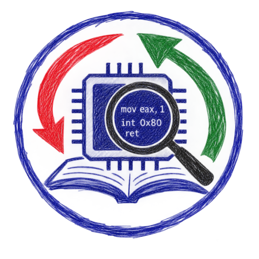
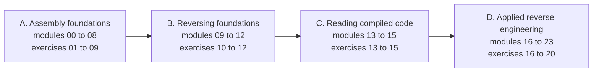

<div align="center">



[English](README.md) | [العربية](README.ar.md) | [Deutsch](README.de.md) | [Español](README.es.md) | [Français](README.fr.md)

# ASM Reversing Lab

</div>

A free, hands-on course that teaches **assembly language** and **reverse engineering** together.
You learn to write x86 and x86-64 assembly, and to read the machine code that compilers
produce, on both Linux and Windows.

Each of the 20 exercises has two parts that depend on each other. In the **Reverse** part you
analyze a provided binary and recover a flag. In the **Assemble** part you write NASM code to a
specification that you can only fully understand after finishing the first part. An automatic
checker tests both.

## Who this is for

You know basic C and want to understand what happens below it. No prior assembly or
reverse engineering experience is needed.

## What you will learn

- Data representation, registers, flags, addressing modes, arithmetic, control flow, strings,
  the stack and calling conventions, in 32-bit and 64-bit code.
- The ELF and PE executable formats and how operating systems load programs.
- A professional toolkit: GDB with GEF, objdump, Rizin and Ghidra.
- Recognizing compiled code structures, optimized arithmetic, data structures and C++ objects.
- Applied analysis: undocumented interfaces, file formats, bug auditing, defensive triage of
  suspicious programs, obfuscated code, bytecode virtual machines, .NET and decompilers.

## Course layout

| Part | Modules | Topic |
|---|---|---|
| A | 00 to 08 | Assembly foundations |
| B | 09 to 12 | Reversing foundations |
| C | 13 to 15 | Reading compiled code |
| D | 16 to 23 | Applied reverse engineering |



Twenty exercises, from Level 1 to Level 5, follow the modules. Start with
[module 00](modules/00-setup/README.md), which sets up the lab.

## Quick start

You need Docker. Every tool is preinstalled in the lab image.

```bash
git clone https://github.com/RiadMoudjahed/asm-reversing-lab.git
cd asm-reversing-lab
make shell
```

Inside the lab, check an exercise with `make check EX=01`. Prefer a native install on
Ubuntu or Debian? Run `sudo scripts/install-native.sh`, then use `make NATIVE=1 <target>`.
Ghidra is installed on your host machine; the setup module explains how.

## Languages

All course pages are available in English, Arabic, German, Spanish and French. The translations
were drafted with AI assistance; corrections from native speakers are welcome (see
[CONTRIBUTING.md](CONTRIBUTING.md)).

## Status

All 24 modules, 20 exercises, cheatsheets and the glossary are written and pass the automated
checks in all five languages.

## Responsible use

Analyze only software you have the right to analyze. Read [ETHICS.md](ETHICS.md) before you
start. The course contains no exploit development, no malware development and nothing on
defeating software protections.

## License

Code is released under the MIT License ([LICENSE](LICENSE)). Written content and diagrams are
released under CC BY-SA 4.0 ([LICENSE-CONTENT](LICENSE-CONTENT)).
